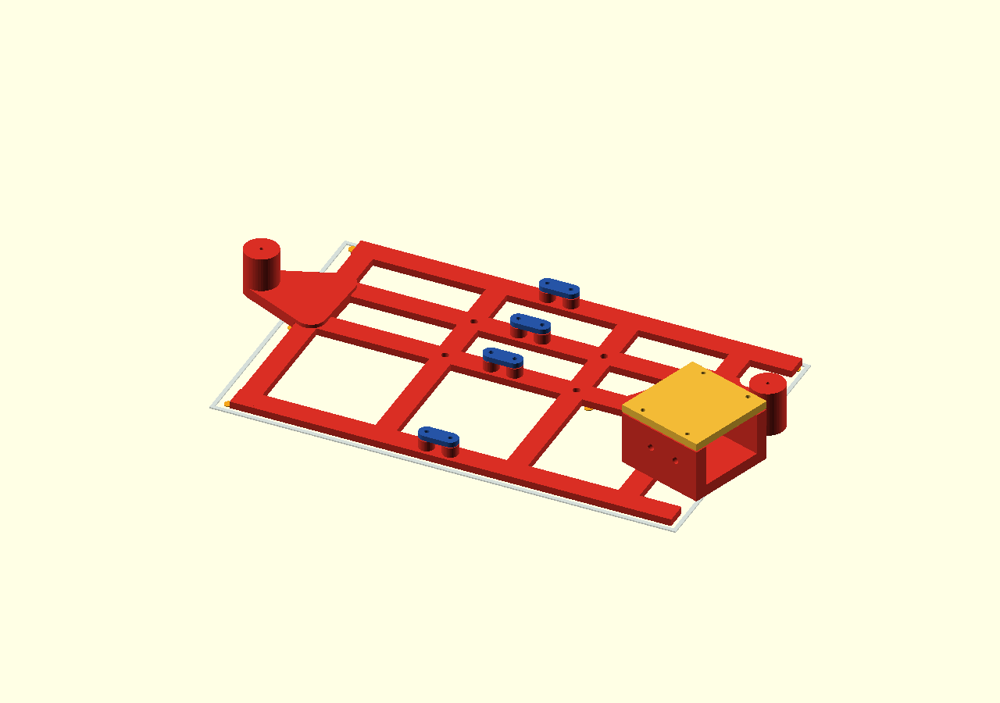

# Guitarra-Matbit — Arturia MiniLab MkII a keytar | V4

> **⛔ BLOQUEO DE TORNILLERÍA (auditoría V5): NO imprimir ni instalar por ahora.** Los 8 centros facilitados anteriormente siguen sin cotejo físico; los otros 11 son estimaciones fotográficas, y el diámetro Ø5,5 mm del CAD no está confirmado. **No se ha cambiado la posición de ningún agujero sin medición.** Consulta la [auditoría exclusiva de tornillos](docs/revision-tornillos.md), la [plantilla 1:1 A3](docs/plantilla_tornillos_A3.svg), las [hojas A4 izquierda](docs/plantilla_tornillos_A4_izquierda.svg) y [derecha](docs/plantilla_tornillos_A4_derecha.svg), y el [registro de comprobación](docs/registro-tornillos.csv). No avanzar con otras mejoras hasta verificar el patrón real.

> **Prototipo CAD, NO validado físicamente.** No usar la correa para sostener el MiniLab ni levantarlo por el alojamiento sin validación estructural. Ningún software garantiza el encaje real o la seguridad.

## [Abrir el modelo 3D completo (STL)](models/stl/assembly_socket.stl)

La V4 sigue la **última instrucción del propietario**: **NO crear ni imprimir mástil**. Solo se ha diseñado un **alojamiento para tu propio listón de madera de sección 50 × 31 mm** en una estructura inferior extraíble para un **Arturia MiniLab MkII**, con las conexiones de correa mediante *strap buttons* metálicos (herraje independiente, no impreso).



### Qué contiene

| Archivo STL | Cantidad | Para qué sirve |
|---|---:|---|
| [assembly_socket.stl](models/stl/assembly_socket.stl) | 1 visualización | Girar y examinar el soporte completo **sin mástil**. Los clips y la tapa aparecen ligeramente separados para verse bien; **no imprimir este conjunto como una sola pieza**. |
| [mount_left.stl](models/stl/mount_left.stl) | 1 | Soporte inferior izquierdo y soporte trasero de strap button |
| [socket_base_right.stl](models/stl/socket_base_right.stl) | 1 | Soporte derecho reforzado con **cuna de madera vacía** |
| [socket_cap.stl](models/stl/socket_cap.stl) | 1 | Tapa separada con cuatro pasos M3 provisionales |
| [join_clip.stl](models/stl/join_clip.stl) | 4 | Clips entre las dos mitades con tornillos e insertos M3 propuestos |
| [wood_fit_coupon.stl](models/stl/wood_fit_coupon.stl) | 1 de prueba | Verificar la holgura en el listón **antes** de imprimir el soporte |
| [screw_fit_coupon.stl](models/stl/screw_fit_coupon.stl) | 1 de prueba | Evaluar paso de tornillos y tolerancias de impresión |

Los STL de la V1/V2 y modos antiguos de mástil metálico o integrado se han retirado del conjunto de publicación vigente para evitar errores. El historial conserva su código.

### Diseño paramétrico

[Editar el modelo en OpenSCAD](cad/keytar.scad). El modo "preview_socket" muestra un contorno del teclado y marca los **ocho puntos indicados por el propietario (azul)** y **once posibles puntos sin medir (dorado, NO perforados)**. El modo "assembly_socket" exporta únicamente las piezas 3D sin madera.

- Dimensiones aportadas de la carcasa: **355 × 221 mm**.
- Interior del alojamiento: **51,2 mm de anchura × 32,2 mm de altura**, por **0,6 mm de holgura provisional por lado** respecto a madera de 50 × 31 mm.
- Longitud total de cuna **70 mm**, con tope interior de **7 mm**; por lo tanto la madera se inserta aproximadamente **63 mm** hasta el tope, sujeto a confirmar.
- Dos pasos transversales provisionales **M5 Ø5,5 mm** en posiciones locales 27 y 50 mm; la madera la perfora el usuario solo después de una comprobación en seco. Nunca taladrar el MiniLab.
- Tapa con cuatro pasos M3; unión inferior mediante cuatro clips y ocho apoyos para insertos M3 (diseño provisional).
- Dos anclajes circulares para botones metálicos de correa, con pilotos ciegos para tornillo **#6 × 25 mm** comunicado por el propietario. **No están ensayados a carga**.

Consulta [medidas y montaje](docs/medidas-y-montaje.md), [auditoría de tornillos](docs/revision-tornillos.md) y [registro de verificación V4](docs/revisiones.md).

### Generación y pruebas reproducibles

Requiere **OpenSCAD** y **Python 3.11+**:

```bash
python -m pip install -r requirements-dev.txt
python -m pytest -q
python scripts/build.py --all --preview
python scripts/validate.py
```

La acción [Generar STL y revisar CAD](.github/workflows/cad.yml) ejecuta pruebas, genera STLs y publica los modelos de la rama sobre models/stl/ cuando termina correctamente. La geometría verificada NO implica prueba de resistencia, encaje, fatiga, holgura ni compatibilidad con los tornillos originales.
